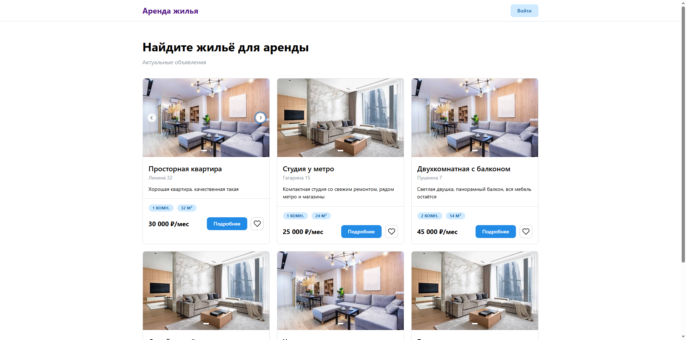
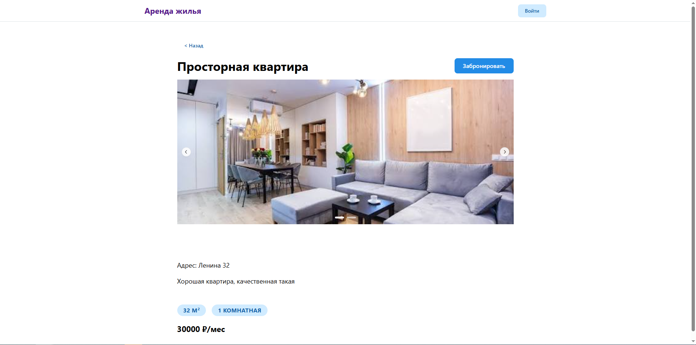
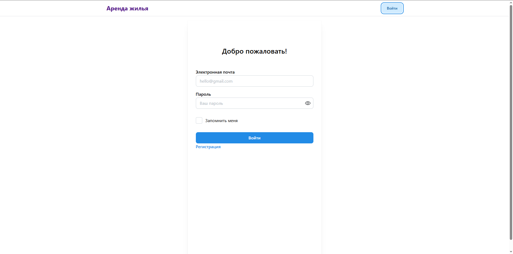
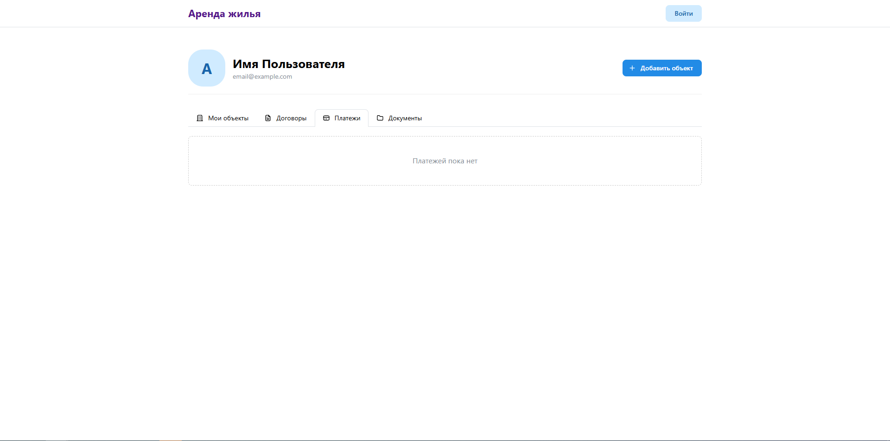

Аренда жилья: объекты недвижимости, договоры аренды, платежи и коммунальные счета, обмен документами между арендатором и арендодателем.

Основные экраны:

Авторизация
Главный экран (витрина объявлений, карточки объявлений)
Профиль (управление объектами, платежи, счета)
Чат (обмен договорами)

Сценарии

Арендодатель
Добавление недвижимости -> создание объявлений
Создание договора -> отправка договора -> подписание
Создание счёта -> отправка арендатору -> получение оплаты

Арендатор
Выбор недвижимости -> бронирование
Просмотр договора -> подписание 
Получение счёта -> оплата -> отправка чека
Передача показаний счётчиков -> расчёт комуналки

Главная страница

Страница объявления

Страница авторизации

Профиль
